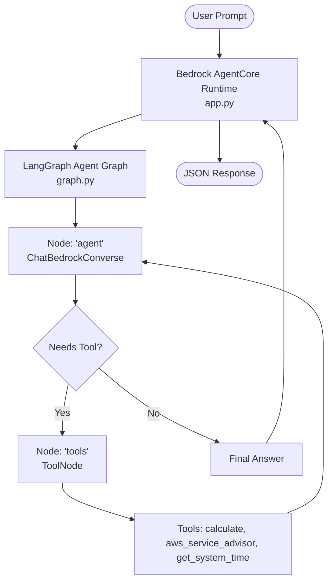

# LangGraph Agent with AWS Bedrock & Bedrock AgentCore

A hands-on, beginner-friendly project for learning AI agents, **LangGraph orchestration**, **Amazon Bedrock foundation models**, and **Amazon Bedrock AgentCore serverless runtime**.

---

## 🌟 Core Concepts Explained

| Component | Role | What It Does |
| :--- | :--- | :--- |
| **Amazon Bedrock** | **Model Provider** | Gives unified API access to Foundation Models (e.g., Amazon Nova, Anthropic Claude, Meta Llama) via the Converse API. |
| **LangGraph** | **Agent Orchestrator** | Coordinates the agent's reasoning loop as a stateful graph (Nodes, Edges, State, and Tools). |
| **Bedrock AgentCore** | **Deployment Runtime** | AWS's enterprise platform for deploying agents as scalable, serverless microservices with persistent memory, MCP gateways, and CloudWatch tracing. |

---

## 🏗️ Architecture & Control Flow



---

## 📁 Project Structure

* [requirements.txt](file:///c:/Users/sujat/projects/AWS/Bedrock/AgnetCore-Prj-3/requirements.txt): Python dependencies (`langchain-aws`, `langgraph`, `bedrock-agentcore`, `boto3`, etc.).
* [.env](file:///c:/Users/sujat/projects/AWS/Bedrock/AgnetCore-Prj-3/.env): AWS region (`ap-south-1`) and Bedrock model selection (`apac.amazon.nova-lite-v1:0`).
* [tools.py](file:///c:/Users/sujat/projects/AWS/Bedrock/AgnetCore-Prj-3/tools.py): Custom tools (`calculate`, `aws_service_advisor`, `get_system_time`).
* [graph.py](file:///c:/Users/sujat/projects/AWS/Bedrock/AgnetCore-Prj-3/graph.py): LangGraph `StateGraph` implementation with Bedrock Converse API binding.
* [app.py](file:///c:/Users/sujat/projects/AWS/Bedrock/AgnetCore-Prj-3/app.py): `BedrockAgentCoreApp` serverless entrypoint and HTTP microservice.
* [test_agent.py](file:///c:/Users/sujat/projects/AWS/Bedrock/AgnetCore-Prj-3/test_agent.py): Interactive terminal interface and automated demo runner.

---

## 🚀 How to Run and Test

### 1. Interactive Terminal Chat
Run the interactive CLI to chat directly with your LangGraph agent:
```powershell
.\myvenv\Scripts\python.exe test_agent.py
```

### 2. Run Predefined Demo Scenarios
Run automated test queries to see tool calling, math reasoning, and AWS knowledge lookups in action:
```powershell
.\myvenv\Scripts\python.exe test_agent.py --demo
```

### 3. Test AgentCore Invocation Locally
Simulate an AWS Bedrock AgentCore invocation payload:
```powershell
.\myvenv\Scripts\python.exe app.py
```

### 4. Run Bedrock AgentCore HTTP Server
Start the production-ready Starlette/Uvicorn server hosting the `/invocations` and `/ping` endpoints:
```powershell
.\myvenv\Scripts\python.exe app.py --serve
```

---

## 💡 How Tools Work in LangGraph

1. **Definition**: Functions are decorated with `@tool` in [tools.py](file:///c:/Users/sujat/projects/AWS/Bedrock/AgnetCore-Prj-3/tools.py).
2. **Binding**: `llm.bind_tools(ALL_TOOLS)` in [graph.py](file:///c:/Users/sujat/projects/AWS/Bedrock/AgnetCore-Prj-3/graph.py) translates Python docstrings and type hints into JSON tool definitions sent to Bedrock Converse API.
3. **Execution**: If the model decides to invoke a tool, `tools_condition` routes state to `ToolNode(ALL_TOOLS)`, executes the function, and feeds the output back into the graph.
