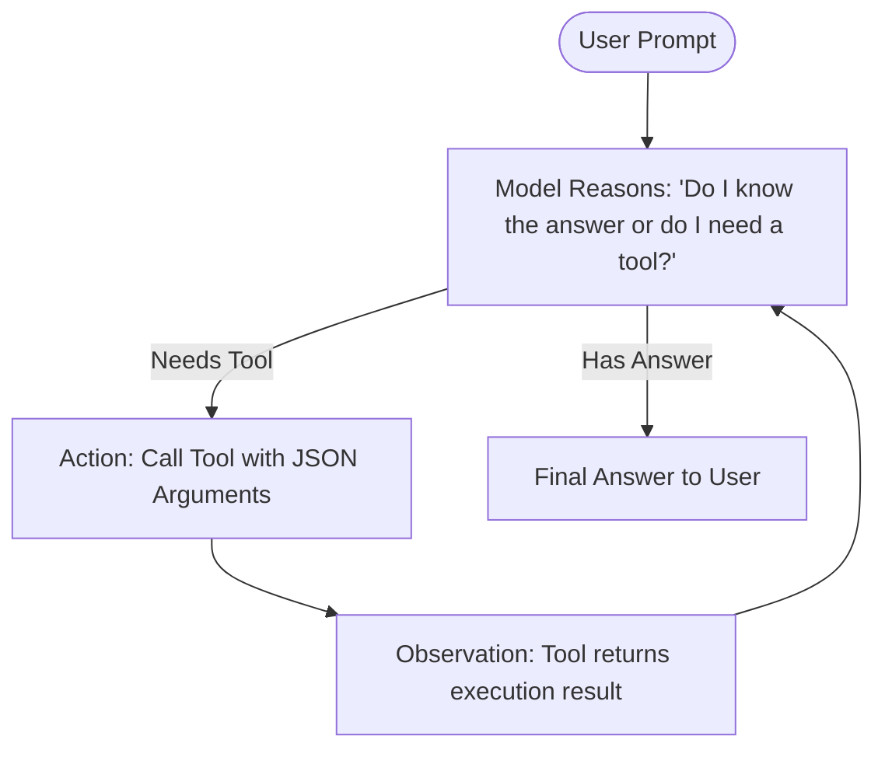
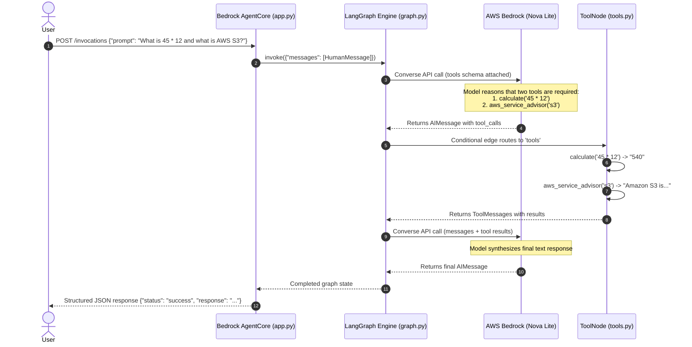

# 📘 Comprehensive Learning Guide: AI Agents with LangGraph & AWS Bedrock

Welcome! This guide is designed for developers learning AI engineering, agentic architecture, and AWS AI services. It explains how all components in this project work together, from core theory to practical code and hands-on exercises.

---

## 📑 Table of Contents
1. [Core AI Concepts: From LLM to Agent](#1-core-ai-concepts-from-llm-to-agent)
2. [AWS Bedrock: The Foundation Model Layer](#2-aws-bedrock-the-foundation-model-layer)
3. [LangGraph: The Agentic Orchestrator](#3-langgraph-the-agentic-orchestrator)
4. [Amazon Bedrock AgentCore: The Serverless Production Runtime](#4-amazon-bedrock-agentcore-the-serverless-production-runtime)
5. [End-to-End Architecture & Control Flow](#5-end-to-end-architecture--control-flow)
6. [Line-by-Line Code Walkthrough](#6-line-by-line-code-walkthrough)
7. [Hands-On Exercises to Deepen Your Skills](#7-hands-on-exercises-to-deepen-your-skills)
8. [Common Gotchas & Troubleshooting](#8-common-gotchas--troubleshooting)

---

## 1. Core AI Concepts: From LLM to Agent

### What is an LLM?
A **Large Language Model (LLM)** is a statistical pattern predictor trained to complete text given a prompt. By itself, an LLM:
* ❌ Cannot perform exact multi-step arithmetic reliably (it guesses tokens).
* ❌ Has a fixed knowledge cutoff date (cannot know current time or live facts).
* ❌ Cannot take real-world actions (e.g., query a database, trigger an API).

### What is an AI Agent?
An **AI Agent** wraps an LLM inside an execution loop equipped with:
1. **Perception**: Receiving input messages and conversation state.
2. **Reasoning**: Deciding what step to take next.
3. **Tools (Action)**: Executing external functions (code, APIs, databases).
4. **Observation**: Reading the result of the tool execution.
5. **Memory**: Retaining state across multi-turn interactions.

### The ReAct Pattern (Reasoning + Acting)
This project implements the standard **ReAct** design pattern:



---

## 2. AWS Bedrock: The Foundation Model Layer

### What is Amazon Bedrock?
Amazon Bedrock is a fully managed AWS service providing unified access to high-performance foundation models from Amazon (Nova), Anthropic (Claude), Meta (Llama), Mistral, and Cohere through a single API.

### Key Bedrock Features Used in this Project:
1. **Converse API**:
   Instead of vendor-specific JSON payloads (e.g. Claude's XML tags vs Llama's format), AWS Bedrock provides a standardized `Converse` API. It standardizes:
   - System prompts
   - Message roles (`user`, `assistant`)
   - Tool calling (`toolConfig`, `toolUse`, `toolResult`)
   - Multi-modal input (text, images, documents)

2. **Inference Profiles**:
   AWS Bedrock uses regional and cross-region inference profiles (e.g., `apac.amazon.nova-lite-v1:0` in `ap-south-1`). Inference profiles automatically route traffic across AWS data centers for high availability and throughput.

3. **LangChain AWS Integration (`ChatBedrockConverse`)**:
   In `graph.py`, we instantiate:
   ```python
   from langchain_aws import ChatBedrockConverse

   llm = ChatBedrockConverse(
       model="apac.amazon.nova-lite-v1:0",
       region_name="ap-south-1",
       temperature=0.1
   )
   ```

---

## 3. LangGraph: The Agentic Orchestrator

### Why LangGraph instead of simple sequential chains?
Traditional LLM chains (like basic LangChain `LLMChain`) are linear pipelines: `Input -> Prompt -> LLM -> Output`.
Real-world agents require **cycles**, **branching**, and **loops** (e.g., try a tool, if it fails try another, repeat until solved).

LangGraph models agentic behavior as a **Directed Cyclic Graph**:

### Core LangGraph Building Blocks:

1. **State (`AgentState`)**:
   A shared typed data structure passed to every node in the graph:
   ```python
   class AgentState(TypedDict):
       messages: Annotated[Sequence[BaseMessage], add_messages]
   ```
   *Why `add_messages`?* It is a **reducer function**. Instead of overwriting `messages` when a node returns a new message, it appends the new message to the list.

2. **Nodes**:
   Python functions or runnables that take `State` as input and return updated state:
   - **`agent` node**: Calls Bedrock Converse with bound tools.
   - **`tools` node (`ToolNode`)**: Looks at the tool calls requested by the model, executes the corresponding Python functions, and returns `ToolMessage` objects.

3. **Edges**:
   - **Fixed Edges**: `START -> agent`, `tools -> agent`.
   - **Conditional Edges (`tools_condition`)**: Inspects the last message. If the model generated `tool_calls`, it routes to `"tools"`. If the model generated plain text, it routes to `END`.

---

## 4. Amazon Bedrock AgentCore: The Serverless Production Runtime

### What is Bedrock AgentCore?
While LangGraph handles the agent's internal reasoning logic in Python, **Amazon Bedrock AgentCore** is the AWS cloud platform designed to deploy, host, secure, and operate agents in production.

### AgentCore Services:
* **Serverless Runtime (`BedrockAgentCoreApp`)**: Runs agent code in isolated, autoscaling execution containers with zero server management.
* **Persistent Memory**: Managed short-term and long-term memory across user sessions.
* **AgentCore Gateway**: Connects agents securely to external enterprise APIs, databases, and Model Context Protocol (MCP) servers.
* **Workload Identity**: Manages IAM roles and OAuth 2.0 credentials so agents can securely access resources on behalf of users.
* **CloudWatch Observability**: Traces prompts, tool execution latencies, and token costs.

### The Entrypoint Pattern (`app.py`):
```python
from bedrock_agentcore import BedrockAgentCoreApp

app = BedrockAgentCoreApp()

@app.entrypoint
def invoke(request: dict) -> dict:
    # Invoked by Bedrock AgentCore serverless container
    user_input = request.get("prompt")
    result = agent_graph.invoke({"messages": [("user", user_input)]})
    return {"response": result["messages"][-1].content}
```

---

## 5. End-to-End Architecture & Control Flow



---

## 6. Line-by-Line Code Walkthrough

### 1. `tools.py`
* **`@tool` decorator**: Converts regular Python functions into LangChain-compatible tools. LangChain reads the function name, type hints, and docstring to generate the JSON schema that AWS Bedrock expects.
* **`calculate(expression: str)`**: Uses a restricted Python `eval` with no `__builtins__` and a whitelist of math functions to prevent code injection while providing accurate math evaluation.
* **`aws_service_advisor(service_name: str)`**: Demonstrates a domain-specific knowledge lookup tool.

### 2. `graph.py`
* **`SYSTEM_PROMPT`**: Guides the persona and tells the LLM when to use tools.
* **`llm.bind_tools(ALL_TOOLS)`**: Informs Bedrock about the tools.
* **`workflow.add_node(...)` & `workflow.add_edge(...)`**: Constructs the graph.
* **`workflow.add_conditional_edges("agent", tools_condition)`**: The core decision fork.

### 3. `app.py`
* **`BedrockAgentCoreApp()`**: Instantiates the production ASGI/Starlette wrapper.
* **`@app.entrypoint`**: Exposes the standard AWS Bedrock AgentCore invocation contract.
* **`--serve` flag**: Launches the local Uvicorn HTTP server exposing `/invocations` and `/ping`.

### 4. `test_agent.py`
* **Interactive CLI loop**: Allows you to test prompts directly in terminal.
* **Reasoning inspector**: Prints tool names, input arguments, and tool outputs as they happen.

---

## 7. Hands-On Exercises to Deepen Your Skills

### 🛠️ Exercise 1: Add a Currency Converter Tool
Open [tools.py](file:///c:/Users/sujat/projects/AWS/Bedrock/AgnetCore-Prj-3/tools.py) and add a new tool:
```python
@tool
def convert_currency(amount: float, from_curr: str, to_curr: str) -> str:
    """Convert between USD, EUR, and INR."""
    rates = {"USD": 1.0, "EUR": 0.92, "INR": 86.5}
    # Calculate conversion and return formatted string
```
Add it to `ALL_TOOLS = [...]`, then run `test_agent.py` and ask:
*"How much is $150 USD in INR?"*

### 🛠️ Exercise 2: Add Conversation Memory
Notice that right now each invocation starts with a fresh state. You can add LangGraph's in-memory checkpointer:
```python
from langgraph.checkpoint.memory import MemorySaver

memory = MemorySaver()
compiled_graph = workflow.compile(checkpointer=memory)
```
Pass a `thread_id` in `config={"configurable": {"thread_id": "session-1"}}` to persist multi-turn context!

### 🛠️ Exercise 3: Model Comparison
Edit [.env](file:///c:/Users/sujat/projects/AWS/Bedrock/AgnetCore-Prj-3/.env) to compare different Bedrock models:
```ini
# Try Nova Micro (ultra-fast, lightweight)
BEDROCK_MODEL_ID=apac.amazon.nova-micro-v1:0

# Or Claude 3.5 Sonnet
BEDROCK_MODEL_ID=apac.anthropic.claude-3-5-sonnet-20240620-v1:0
```
Observe differences in reasoning style and latency.

---

## 8. Common Gotchas & Troubleshooting

| Issue / Error | Cause | Solution |
| :--- | :--- | :--- |
| `ResourceNotFoundException (model EOL)` | Model ID deprecated (e.g. Claude 3 Haiku legacy). | Switch to active inference profile (e.g., `apac.amazon.nova-lite-v1:0`). |
| `ThrottlingException (quota hit)` | Hit daily account token limit in a region. | Switch region in `.env` (e.g., `ap-south-1` vs `us-east-1`) or use a lighter model. |
| `ValidationException: Model doesn't support tools` | Older models (like original Llama 3.0) do not support function calling. | Use models supporting tool calling (Amazon Nova, Llama 3.1/3.2, Claude 3.5). |
| `Missing credentials` | AWS CLI not logged in. | Run `aws configure` or check `aws sts get-caller-identity`. |

---

Happy Building! 🚀
